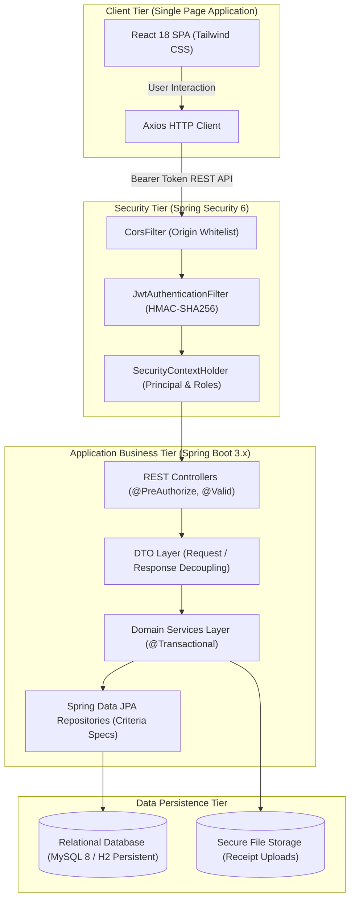
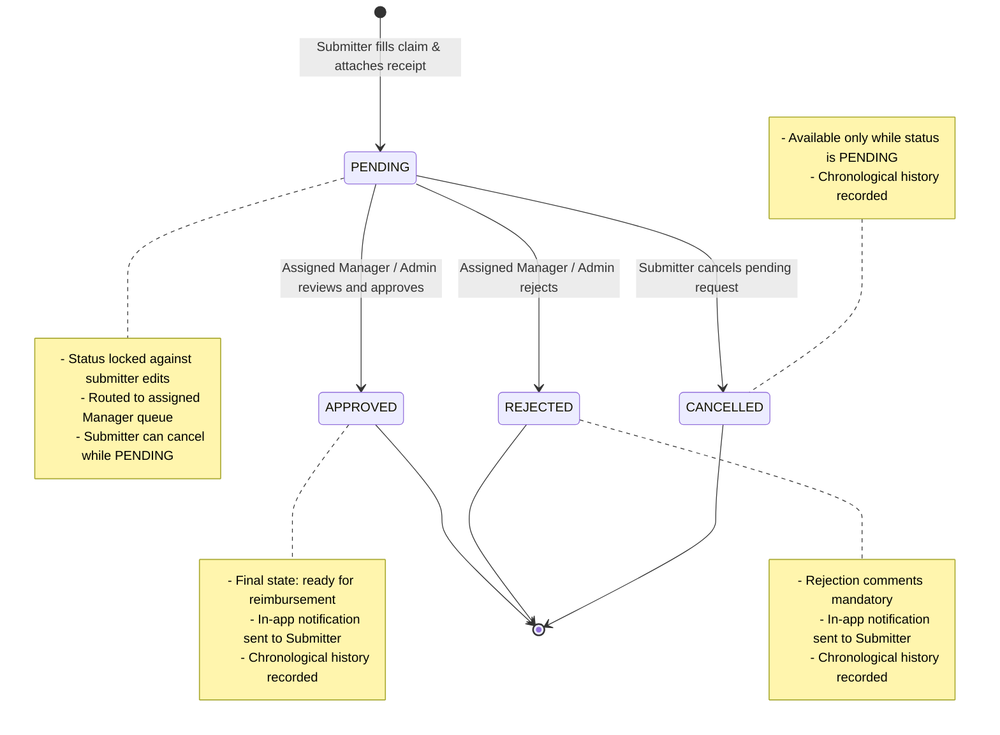
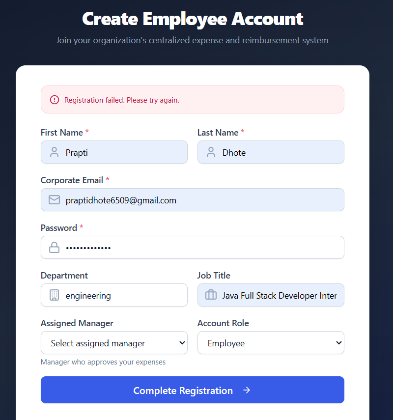

# Team Expense Approval and Management System

[](https://spring.io/projects/spring-boot)
[](https://reactjs.org/)
[](https://vitejs.dev/)
[](https://tailwindcss.com/)
[](https://www.oracle.com/java/)
[](https://jwt.io/)
[](LICENSE)

An enterprise-grade full-stack web application designed for small and medium-sized organizations to automate employee expense reimbursements, enforce multi-tier managerial approval workflows, prevent unauthorized claims, and deliver real-time financial expenditure analytics.

---

## Table of Contents
1. [Business Problem & Solution](#1-business-problem--solution)
2. [Technology Stack](#2-technology-stack)
3. [System Architecture](#3-system-architecture)
4. [Approval Workflow State Machine](#4-approval-workflow-state-machine)
5. [Database Design & ER Diagram](#5-database-design--er-diagram)
6. [Core Implemented Features](#6-core-implemented-features)
7. [REST API Documentation](#7-rest-api-documentation)
8. [Key Engineering Decisions (Interview Talking Points)](#8-key-engineering-decisions-interview-talking-points)
9. [Local Setup & Running Guide](#9-local-setup--running-guide)
10. [Demo Credentials](#10-demo-credentials)
11. [Testing & Build Verification](#11-testing--build-verification)
12. [User Interface & Screenshots](#12-user-interface--screenshots)
13. [Recommended Git Commit History](#13-recommended-git-commit-history)

---

## 1. Business Problem & Solution

### The Business Challenge
Manual expense management via spreadsheets and physical paper receipts suffers from critical flaws:
- **Reimbursement Delays**: Lost email threads and manual routing delay employee repayments.
- **Budget Blindspots**: Finance directors cannot forecast spending or review category-level expenses in real time.
- **Compliance & Fraud Vulnerabilities**: Lack of segregation of duties allows self-approvals, double-claim submissions, and unreviewed discretionary spending.
- **Auditing Gaps**: No immutable compliance log to prove who approved, rejected, or modified a claim.

### The Engineered Solution
This centralized platform automates the entire reimbursement lifecycle:
- **Employees**: Submit claims with itemized digital receipts (JPG, PNG, PDF), track approval status in real time, and cancel pending claims.
- **Managers**: Review assigned direct reports' claims, inspect uploaded invoices, approve verified costs, or reject claims with mandatory explanations.
- **Administrators**: Maintain company-wide expenditure oversight, manage departmental categories, assign employee-to-manager hierarchies, export RFC 4180 compliant CSV reports, and review immutable compliance audit logs.

---

## 2. Technology Stack

### Frontend
- **Framework**: React 18 (Vite build tool)
- **Styling**: Tailwind CSS
- **Icons**: Lucide React
- **Data Visualization**: Recharts (Interactive Bar, Pie, and Area charts)
- **Routing**: React Router DOM v6 with role-based Route Guards
- **HTTP Client**: Axios with Bearer token request interceptor and 401 session-expiration handler

### Backend
- **Framework**: Spring Boot 3.3.5
- **Language**: Java 17 LTS
- **Security**: Spring Security 6 with stateless JWT authentication filter (`io.jsonwebtoken` 0.12.6)
- **Data Access**: Spring Data JPA & Hibernate ORM 6
- **Validation**: Jakarta Bean Validation (`@Valid`, `@PastOrPresent`, `@DecimalMin`, `@Size`)
- **Build Tool**: Apache Maven 3.9+

### Persistence
- **Production Mode**: MySQL 8.x
- **Zero-Setup Local Dev Mode**: File-based persistent embedded database (`./data/expensedb`) with MySQL compatibility mode (allows instant local execution without installing MySQL server)
- **Testing**: H2 in-memory isolated database

---

## 3. System Architecture



---

## 4. Approval Workflow State Machine

The state machine enforces company segregation of duties and immutability:



---

## 5. Database Design & ER Diagram

The relational schema is normalized into 8 primary entities:


---

## 6. Core Implemented Features

### A. Employee Self-Service
- **Submit Expense Claim**: Title, active category dropdown, exact monetary amount, expense date (past or present only), payment method, business justification, and receipt attachment.
- **File Upload Verification**: Whitelisted `.jpg`, `.jpeg`, `.png`, `.pdf` up to 5MB with UUID storage filenames preventing directory traversal.
- **My Expenses Dashboard**: Paginated table with real-time status badges, category filter, date range filter, and keyword search.
- **Cancellation Window**: Submitter can withdraw a claim while its status is `PENDING`.
- **Expense Breakdown & Timeline**: Detailed view displaying receipt download link and full chronological status audit trail.

### B. Manager Approval Suite
- **Manager Dashboard**: Overview of pending reviews, total team spend, approved count, and rejected count.
- **Scoped Review Queue**: Managers can view and review **only** their assigned direct reports' claims.
- **Interactive Review Modal**: Inspect invoice details and receipt before decision.
- **Mandatory Rejection Feedback**: Form enforces non-empty comments when declining an expense to guide the employee.
- **Segregation of Duties**: Managers cannot approve their own expense submissions.

### C. Administrator Governance
- **Executive Spend Overview**: Organization-wide approved spending, pending liability, claims volume, and monthly trend graphs.
- **Category Spending Distribution**: Interactive Recharts donut chart showing department budget distribution.
- **User Directory**: View workforce accounts, toggle account status (activate/deactivate), and assign reporting managers.
- **Category Management**: Create, edit, and deactivate expense categories.
- **Compliance Audit Log**: Detailed log tracking actors, actions, target entity IDs, timestamps, and details.

### D. Financial Reporting & CSV Export
- **Multi-Filter Report**: Filter company claims by Category, Status, Employee, and Date Range.
- **Aggregate Summary**: On-screen calculations of total claims count, approved amount, pending amount, and rejected amount.
- **RFC 4180 CSV Download**: Generates downloadable `.csv` spreadsheet files formatted for accounting software.
- **Printable Report View**: Dedicated CSS print view (`window.print()`) that suppresses navigation chrome for clean printing.

### E. In-App Notification Center
- **Unread Badge Counter**: Top navigation bell indicator showing unread alerts.
- **Status Change Alerts**: Employees receive instant notifications when claims are approved or rejected.
- **New Submission Alerts**: Managers are notified when a direct report submits a claim.
- **Mark Read**: Single-click individual read or "Mark all as read".

---

## 7. REST API Documentation

All API responses follow a standardized JSON envelope:
```json
{
  "success": true,
  "message": "Operation completed successfully",
  "data": { ... },
  "timestamp": "2026-11-20T13:26:05"
}
```

### Endpoints Catalog

| Module | HTTP Verb | Endpoint | Access / Role | Description |
| :--- | :--- | :--- | :--- | :--- |
| **Auth** | `POST` | `/api/auth/register` | Public | Register new employee or manager account |
| **Auth** | `POST` | `/api/auth/login` | Public | Authenticate user & return signed JWT |
| **Auth** | `GET` | `/api/auth/me` | Authenticated | Retrieve authenticated user profile & roles |
| **Expenses** | `POST` | `/api/expenses` | Employee | Submit expense claim with multipart receipt file |
| **Expenses** | `GET` | `/api/expenses/my` | Employee | List current user's submitted claims (paginated) |
| **Expenses** | `GET` | `/api/expenses/{id}` | Submitter / Mgr / Admin | Get expense details (enforces IDOR protection) |
| **Expenses** | `GET` | `/api/expenses/{id}/history` | Submitter / Mgr / Admin | Get status change chronological history |
| **Expenses** | `PUT` | `/api/expenses/{id}` | Submitter | Edit expense (allowed **only** if status is PENDING) |
| **Expenses** | `PATCH`| `/api/expenses/{id}/cancel` | Submitter | Cancel pending expense request |
| **Expenses** | `GET` | `/api/expenses/{id}/receipt` | Submitter / Mgr / Admin | Download / preview uploaded receipt file |
| **Approvals**| `GET` | `/api/approvals/pending` | Manager / Admin | Get pending expenses for assigned direct reports |
| **Approvals**| `POST` | `/api/approvals/{id}/review` | Manager / Admin | Approve or Reject expense with comments |
| **Approvals**| `GET` | `/api/approvals/history` | Manager / Admin | Review audit history of previously processed claims |
| **Categories**| `GET` | `/api/categories` | Authenticated | List all active categories for submission form |
| **Categories**| `GET` | `/api/categories/all` | Admin | List all categories including inactive ones |
| **Categories**| `POST` | `/api/categories` | Admin | Create a new expense category |
| **Categories**| `PUT` | `/api/categories/{id}` | Admin | Update category name & description |
| **Categories**| `DELETE`| `/api/categories/{id}` | Admin | Deactivate category |
| **Users** | `GET` | `/api/users` | Admin | List all users (paginated) |
| **Users** | `GET` | `/api/users/managers` | Authenticated | List active managers for dropdown selection |
| **Users** | `PUT` | `/api/users/{id}/status` | Admin | Activate or deactivate account |
| **Users** | `PUT` | `/api/users/{id}/assign-manager` | Admin | Assign reporting manager to employee |
| **Dashboard**| `GET` | `/api/dashboard/employee` | Employee | Submitter metrics, monthly trends, recent claims |
| **Dashboard**| `GET` | `/api/dashboard/manager` | Manager / Admin | Team pending count, total reviewed, team spend |
| **Dashboard**| `GET` | `/api/dashboard/admin` | Admin | Company-wide spending, category breakdown, trends |
| **Reports** | `GET` | `/api/reports/expenses` | Manager / Admin | Filtered list with multi-parameter criteria |
| **Reports** | `GET` | `/api/reports/summary` | Manager / Admin | Aggregate financial totals (counts, sums) |
| **Reports** | `GET` | `/api/reports/export/csv` | Manager / Admin | Export filtered claims to downloadable RFC 4180 CSV |
| **Notifications** | `GET` | `/api/notifications` | Authenticated | Paginated in-app notifications |
| **Notifications** | `GET` | `/api/notifications/recent` | Authenticated | Top 10 recent notifications |
| **Notifications** | `GET` | `/api/notifications/unread-count` | Authenticated | Unread alerts count |
| **Notifications** | `PATCH`| `/api/notifications/{id}/read` | Authenticated | Mark individual notification as read |
| **Notifications** | `PATCH`| `/api/notifications/read-all` | Authenticated | Mark all notifications as read |
| **Audit Logs** | `GET` | `/api/audit-logs` | Admin | System compliance audit trail |

---

## 8. Key Engineering Decisions (Interview Talking Points)

### 1. Why `BigDecimal` for Money Instead of `double` or `float`?
Binary floating-point types (`double`, `float`) represent numbers as powers of 2 (IEEE 754). In financial arithmetic, fractions like `0.10` cannot be represented exactly, leading to cumulative rounding errors (e.g., `0.1 + 0.2 = 0.30000000000000004`).
- **Database**: `DECIMAL(12, 2)`
- **Java Entity**: `java.math.BigDecimal`
- Guarantees exact penny arithmetic for corporate balance sheets.

### 2. IDOR (Insecure Direct Object Reference) Prevention
Numeric IDs in REST APIs (e.g., `GET /api/expenses/42`) are susceptible to enumeration attacks. The service layer validates object-level permissions on every read, write, and receipt download:
$$\text{Access Granted} \iff (\text{expense.user} == \text{current}) \lor (\text{expense.user.manager} == \text{current}) \lor (\text{current has ROLE\_ADMIN})$$
Unauthorized access triggers `ForbiddenException` (HTTP 403).

### 3. Clean Layered Architecture & SOLID Principles
- **Controller Layer**: Handles HTTP requests, performs JSR-380 input validation (`@Valid`), extracts authenticated principal from `SecurityContext`, and delegates directly to services. Contains **no business logic**.
- **Service Layer**: Manages `@Transactional` boundaries, enforces business rules (such as mandatory rejection feedback), and dispatches notifications.
- **Repository Layer**: Utilizes Spring Data JPA and dynamic `Specification<Expense>` queries for multi-parameter filtering without writing manual SQL concatenation.
- **DTO Abstraction**: JPA entities are never exposed directly to clients, protecting against mass-assignment vulnerabilities and cyclical serialization loops.

### 4. Zero-Setup Default Persistence with MySQL Readiness
The default configuration uses a file-based persistent database (`./data/expensedb`) in MySQL compatibility mode. This allows any evaluator or recruiter to clone and run the application with **zero external software installation**, while still providing an automated switch to MySQL 8 via environment variables or `--spring.profiles.active=mysql`.

---

## 9. Local Setup & Running Guide

### Prerequisites
- Java Development Kit (JDK) 17 or higher
- Node.js 18+ and npm

### 1. Start Backend (Spring Boot 3)
```powershell
cd backend
mvn clean test
mvn spring-boot:run
```
- Server starts on `http://localhost:8080`.
- Baseline roles, standard categories, and seed accounts initialize automatically via `DataInitializer`.
- Database console is accessible at `http://localhost:8080/h2-console` (JDBC URL: `jdbc:h2:file:./data/expensedb`, Username: `sa`, Password: empty).

*(Optional MySQL Mode)*: If you wish to use a local MySQL server instead of the embedded persistent database:
```powershell
mysql -u root -p < database/schema.sql
mvn spring-boot:run -Dspring-boot.run.profiles=mysql
```

### 2. Start Frontend (React + Vite)
```powershell
cd frontend
npm install
npm run dev
```
- Open `http://localhost:5173` in your browser.

---

## 10. Demo Credentials

The login screen provides **one-click demo login buttons** to populate test credentials instantly:

| Role | Email | Password | Primary Capabilities |
| :--- | :--- | :--- | :--- |
| **Employee** | `employee@company.com` | `Employee123!` | Submit claims, upload receipts, track status, cancel requests |
| **Manager** | `manager@company.com` | `Manager123!` | Review direct report requests, approve, reject with reasons |
| **Admin** | `admin@company.com` | `Admin123!` | Executive dashboard, manage users & managers, category CRUD, reports |

You can also register a brand new account from the registration page or use:
- **Verified Custom Account**: `praptidhote6509@gmail.com` / `Password123!`

---

## 11. Testing & Build Verification

### Backend Automated Test Suite (18 Tests Passing)
```
[INFO] -------------------------------------------------------
[INFO]  T E S T S
[INFO] -------------------------------------------------------
[INFO] Running com.expensemanagement.service.ApprovalServiceTest
[INFO] Tests run: 4, Failures: 0, Errors: 0, Skipped: 0
[INFO] Running com.expensemanagement.service.AuthServiceTest
[INFO] Tests run: 4, Failures: 0, Errors: 0, Skipped: 0
[INFO] Running com.expensemanagement.service.ExpenseServiceTest
[INFO] Tests run: 5, Failures: 0, Errors: 0, Skipped: 0
[INFO] Running com.expensemanagement.service.ReportServiceTest
[INFO] Tests run: 2, Failures: 0, Errors: 0, Skipped: 0
[INFO] Running com.expensemanagement.service.UserServiceTest
[INFO] Tests run: 3, Failures: 0, Errors: 0, Skipped: 0
[INFO] 
[INFO] Results:
[INFO] Tests run: 18, Failures: 0, Errors: 0, Skipped: 0
[INFO] ------------------------------------------------------------------------
[INFO] BUILD SUCCESS
```

### Frontend Production Build Verification
```
> vite build
vite v5.4.21 building for production...
✓ 2284 modules transformed.
dist/index.html                   0.85 kB
dist/assets/index-BYTNPkVJ.css   30.49 kB
dist/assets/index-DJlhcejr.js   747.73 kB
✓ built in 6.97s
```

---

## 12. User Interface & Screenshots

### Account Registration Screen
Clean corporate registration layout with department, job title, and assigned manager selection:



### Screen Directory Overview
- **Employee Portal**:
  - `My Dashboard`: Personal metric cards, monthly spending trend chart, and recent claims table.
  - `Submit Expense`: Itemized claim form with drag-and-drop receipt upload.
  - `My Expenses`: Filterable data table with status badges and cancellation buttons.
  - `Expense Details`: Claim breakdown with invoice download link and chronological audit history.
- **Manager Suite**:
  - `Manager Dashboard`: Direct report metrics, team spend counters, and pending approvals summary.
  - `Pending Approvals`: Dedicated review queue with one-click approval and mandatory rejection reasoning modal.
- **Admin Governance**:
  - `Admin Overview`: Organization-wide expenditure metrics and category spend distribution donut charts.
  - `User Directory`: Workforce table with manager assignment modal and account status toggles.
  - `Categories`: Add, edit, or deactivate company reimbursement categories.
  - `System Audit Trail`: Complete activity log of all financial and authorization events.
- **Analytics & Export**:
  - `Expense Reports`: Multi-parameter filtered report with instant RFC 4180 CSV export and print view.

---

## 13. Recommended Git Commit History

When pushing this codebase to your GitHub profile, commit in progressive, professional increments to demonstrate real-world software engineering workflow to technical recruiters:

1. **`feat: initialize repository with project specification and database schema`**
   - Add `.gitignore`, `database/schema.sql`, and `database/sample-data.sql`.
2. **`feat(backend): configure spring boot 3, jpa entities, and repositories`**
   - Implement `User`, `Role`, `ExpenseCategory`, `Expense`, `ExpenseApproval`, `ExpenseStatusHistory`, `Notification`, and `AuditLog` entities.
3. **`feat(security): implement spring security 6, bcrypt, and jwt filter chain`**
   - Add `JwtTokenProvider`, `JwtAuthenticationFilter`, `UserPrincipal`, `CorsConfig`, and `SecurityConfig`.
4. **`feat(service): implement core expense submission, approval workflow, and audit logging`**
   - Add `ExpenseServiceImpl`, `ApprovalServiceImpl`, `ReportServiceImpl`, `FileStorageServiceImpl`, and `NotificationServiceImpl`.
5. **`test(backend): add unit and integration test suite with junit 5 and mockito`**
   - Add unit tests for Auth, Approval, Expense, Report, and User services (18 tests).
6. **`feat(frontend): build react 18 spa with tailwind css and role-based dashboards`**
   - Implement Employee, Manager, and Admin dashboards, forms, Recharts visualizations, and Axios interceptors.
7. **`docs: add comprehensive readme with architecture diagrams, api specs, and setup instructions`**
   - Add complete `README.md`, Mermaid ER diagrams, workflow state machine, and Postman collection.

---

## Author & Project Info
- **Project**: Team Expense Approval & Management System
- **Intended Role**: Associate Software Engineer / Full-Stack Java Developer Portfolio
- **Designed & Implemented by**: Prapti Dhote (B.E. Information Technology)
