# Team Expense Approval and Management System

[](https://team-expense-management-system.onrender.com)
[](https://spring.io/projects/spring-boot)
[](https://reactjs.org/)
[](https://vitejs.dev/)
[](https://tailwindcss.com/)
[](https://www.oracle.com/java/)
[](https://jwt.io/)
[](LICENSE)

> 🚀 **Live Production Application**: **[https://team-expense-management-system.onrender.com](https://team-expense-management-system.onrender.com)**  
> *Ready for evaluation: Features instant 1-click test login buttons for Employee, Manager, and Admin accounts.*

An enterprise-grade full-stack web application designed for small and medium-sized organizations to automate employee expense reimbursements, enforce multi-tier managerial approval workflows, prevent unauthorized claims, and deliver real-time financial expenditure analytics.

---

## Table of Contents
1. [Business Problem & Solution](#1-business-problem--solution)
2. [Technology Stack](#2-technology-stack)
3. [System Architecture](#3-system-architecture)
4. [Approval Workflow State Machine](#4-approval-workflow-state-machine)
5. [Database Design & ER Diagram](#5-database-design--er-diagram)
6. [Core Implemented Features](#6-core-implemented-features)
7. [REST API Documentation](#7-rest-api-documentation)
8. [Key Engineering Decisions (Interview Talking Points)](#8-key-engineering-decisions-interview-talking-points)
9. [Local Setup & Running Guide](#9-local-setup--running-guide)
10. [Demo Credentials](#10-demo-credentials)
11. [Testing & Build Verification](#11-testing--build-verification)
12. [User Interface & Screenshots Walkthrough](#12-user-interface--screenshots-walkthrough)
13. [Recommended Git Commit History](#13-recommended-git-commit-history)

---

## 1. Business Problem & Solution

### The Business Challenge
Manual expense management via spreadsheets and physical paper receipts suffers from critical flaws:
- **Reimbursement Delays**: Lost email threads and manual routing delay employee repayments.
- **Budget Blindspots**: Finance directors cannot forecast spending or review category-level expenses in real time.
- **Compliance & Fraud Vulnerabilities**: Lack of segregation of duties allows self-approvals, double-claim submissions, and unreviewed discretionary spending.
- **Auditing Gaps**: No immutable compliance log to prove who approved, rejected, or modified a claim.

### The Engineered Solution
This centralized platform automates the entire reimbursement lifecycle:
- **Employees**: Submit claims with itemized digital receipts (JPG, PNG, PDF), track approval status in real time, and cancel pending claims.
- **Managers**: Review assigned direct reports' claims, inspect uploaded invoices, approve verified costs, or reject claims with mandatory explanations.
- **Administrators**: Maintain company-wide expenditure oversight, manage departmental categories, assign employee-to-manager hierarchies, export RFC 4180 compliant CSV reports, and review immutable compliance audit logs.

---

## 2. Technology Stack

### Frontend
- **Framework**: React 18 (Vite build tool)
- **Styling**: Tailwind CSS
- **Icons**: Lucide React
- **Data Visualization**: Recharts (Interactive Bar, Pie, and Area charts)
- **Routing**: React Router DOM v6 with role-based Route Guards
- **HTTP Client**: Axios with Bearer token request interceptor and 401 session-expiration handler

### Backend
- **Framework**: Spring Boot 3.3.5
- **Language**: Java 17 LTS
- **Security**: Spring Security 6 with stateless JWT authentication filter (`io.jsonwebtoken` 0.12.6)
- **Data Access**: Spring Data JPA & Hibernate ORM 6
- **Validation**: Jakarta Bean Validation (`@Valid`, `@PastOrPresent`, `@DecimalMin`, `@Size`)
- **Build Tool**: Apache Maven 3.9+

### Persistence
- **Production Mode**: MySQL 8.x
- **Zero-Setup Local Dev Mode**: File-based persistent embedded database (`./data/expensedb`) with MySQL compatibility mode (allows instant local execution without installing MySQL server)
- **Testing**: H2 in-memory isolated database

---

## 3. System Architecture

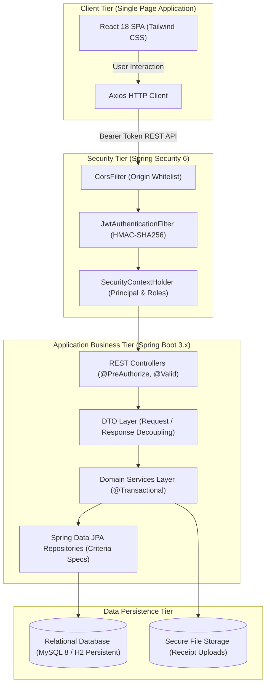

---

## 4. Approval Workflow State Machine

The state machine enforces company segregation of duties and immutability:

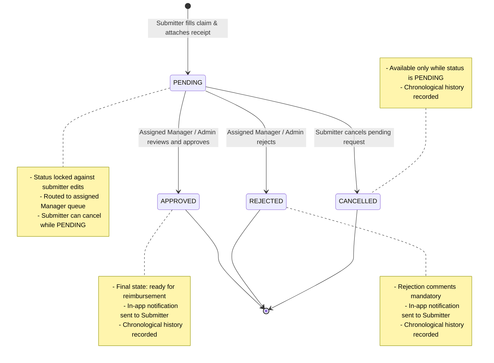

---

## 5. Database Design & ER Diagram

The relational schema is normalized into 8 primary entities:

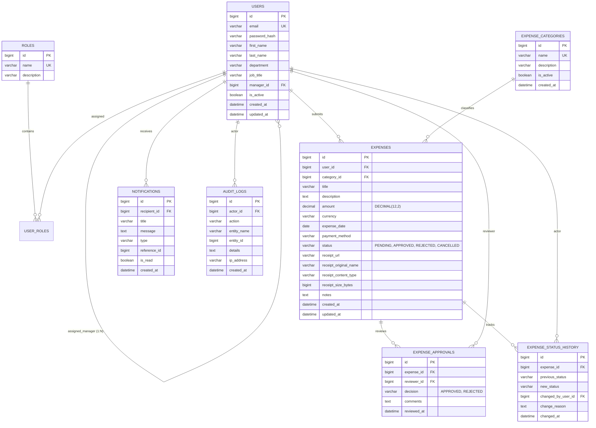

---

## 6. Core Implemented Features

### A. Employee Self-Service
- **Submit Expense Claim**: Title, active category dropdown, exact monetary amount, expense date (past or present only), payment method, business justification, and receipt attachment.
- **File Upload Verification**: Whitelisted `.jpg`, `.jpeg`, `.png`, `.pdf` up to 5MB with UUID storage filenames preventing directory traversal.
- **My Expenses Dashboard**: Paginated table with real-time status badges, category filter, date range filter, and keyword search.
- **Cancellation Window**: Submitter can withdraw a claim while its status is `PENDING`.
- **Expense Breakdown & Timeline**: Detailed view displaying receipt download link and full chronological status audit trail.

### B. Manager Approval Suite
- **Manager Dashboard**: Overview of pending reviews, total team spend, approved count, and rejected count.
- **Scoped Review Queue**: Managers can view and review **only** their assigned direct reports' claims.
- **Interactive Review Modal**: Inspect invoice details and receipt before decision.
- **Mandatory Rejection Feedback**: Form enforces non-empty comments when declining an expense to guide the employee.
- **Segregation of Duties**: Managers cannot approve their own expense submissions.

### C. Administrator Governance
- **Executive Spend Overview**: Organization-wide approved spending, pending liability, claims volume, and monthly trend graphs.
- **Category Spending Distribution**: Interactive Recharts donut chart showing department budget distribution.
- **User Directory**: View workforce accounts, toggle account status (activate/deactivate), and assign reporting managers.
- **Category Management**: Create, edit, and deactivate expense categories.
- **Compliance Audit Log**: Detailed log tracking actors, actions, target entity IDs, timestamps, and details.

### D. Financial Reporting & CSV Export
- **Multi-Filter Report**: Filter company claims by Category, Status, Employee, and Date Range.
- **Aggregate Summary**: On-screen calculations of total claims count, approved amount, pending amount, and rejected amount.
- **RFC 4180 CSV Download**: Generates downloadable `.csv` spreadsheet files formatted for accounting software.
- **Printable Report View**: Dedicated CSS print view (`window.print()`) that suppresses navigation chrome for clean printing.

### E. In-App Notification Center
- **Unread Badge Counter**: Top navigation bell indicator showing unread alerts.
- **Status Change Alerts**: Employees receive instant notifications when claims are approved or rejected.
- **New Submission Alerts**: Managers are notified when a direct report submits a claim.
- **Mark Read**: Single-click individual read or "Mark all as read".

---

## 7. REST API Documentation

All API responses follow a standardized JSON envelope:
```json
{
  "success": true,
  "message": "Operation completed successfully",
  "data": { ... },
  "timestamp": "2026-11-20T13:26:05"
}
```

### Endpoints Catalog

| Module | HTTP Verb | Endpoint | Access / Role | Description |
| :--- | :--- | :--- | :--- | :--- |
| **Auth** | `POST` | `/api/auth/register` | Public | Register new employee or manager account |
| **Auth** | `POST` | `/api/auth/login` | Public | Authenticate user & return signed JWT |
| **Auth** | `GET` | `/api/auth/me` | Authenticated | Retrieve authenticated user profile & roles |
| **Expenses** | `POST` | `/api/expenses` | Employee | Submit expense claim with multipart receipt file |
| **Expenses** | `GET` | `/api/expenses/my` | Employee | List current user's submitted claims (paginated) |
| **Expenses** | `GET` | `/api/expenses/{id}` | Submitter / Mgr / Admin | Get expense details (enforces IDOR protection) |
| **Expenses** | `GET` | `/api/expenses/{id}/history` | Submitter / Mgr / Admin | Get status change chronological history |
| **Expenses** | `PUT` | `/api/expenses/{id}` | Submitter | Edit expense (allowed **only** if status is PENDING) |
| **Expenses** | `PATCH`| `/api/expenses/{id}/cancel` | Submitter | Cancel pending expense request |
| **Expenses** | `GET` | `/api/expenses/{id}/receipt` | Submitter / Mgr / Admin | Download / preview uploaded receipt file |
| **Approvals**| `GET` | `/api/approvals/pending` | Manager / Admin | Get pending expenses for assigned direct reports |
| **Approvals**| `POST` | `/api/approvals/{id}/review` | Manager / Admin | Approve or Reject expense with comments |
| **Approvals**| `GET` | `/api/approvals/history` | Manager / Admin | Review audit history of previously processed claims |
| **Categories**| `GET` | `/api/categories` | Authenticated | List all active categories for submission form |
| **Categories**| `GET` | `/api/categories/all` | Admin | List all categories including inactive ones |
| **Categories**| `POST` | `/api/categories` | Admin | Create a new expense category |
| **Categories**| `PUT` | `/api/categories/{id}` | Admin | Update category name & description |
| **Categories**| `DELETE`| `/api/categories/{id}` | Admin | Deactivate category |
| **Users** | `GET` | `/api/users` | Admin | List all users (paginated) |
| **Users** | `GET` | `/api/users/managers` | Authenticated | List active managers for dropdown selection |
| **Users** | `PUT` | `/api/users/{id}/status` | Admin | Activate or deactivate account |
| **Users** | `PUT` | `/api/users/{id}/assign-manager` | Admin | Assign reporting manager to employee |
| **Dashboard**| `GET` | `/api/dashboard/employee` | Employee | Submitter metrics, monthly trends, recent claims |
| **Dashboard**| `GET` | `/api/dashboard/manager` | Manager / Admin | Team pending count, total reviewed, team spend |
| **Dashboard**| `GET` | `/api/dashboard/admin` | Admin | Company-wide spending, category breakdown, trends |
| **Reports** | `GET` | `/api/reports/expenses` | Manager / Admin | Filtered list with multi-parameter criteria |
| **Reports** | `GET` | `/api/reports/summary` | Manager / Admin | Aggregate financial totals (counts, sums) |
| **Reports** | `GET` | `/api/reports/export/csv` | Manager / Admin | Export filtered claims to downloadable RFC 4180 CSV |
| **Notifications** | `GET` | `/api/notifications` | Authenticated | Paginated in-app notifications |
| **Notifications** | `GET` | `/api/notifications/recent` | Authenticated | Top 10 recent notifications |
| **Notifications** | `GET` | `/api/notifications/unread-count` | Authenticated | Unread alerts count |
| **Notifications** | `PATCH`| `/api/notifications/{id}/read` | Authenticated | Mark individual notification as read |
| **Notifications** | `PATCH`| `/api/notifications/read-all` | Authenticated | Mark all notifications as read |
| **Audit Logs** | `GET` | `/api/audit-logs` | Admin | System compliance audit trail |

---

## 8. Key Engineering Decisions (Interview Talking Points)

### 1. Why `BigDecimal` for Money Instead of `double` or `float`?
Binary floating-point types (`double`, `float`) represent numbers as powers of 2 (IEEE 754). In financial arithmetic, fractions like `0.10` cannot be represented exactly, leading to cumulative rounding errors (e.g., `0.1 + 0.2 = 0.30000000000000004`).
- **Database**: `DECIMAL(12, 2)`
- **Java Entity**: `java.math.BigDecimal`
- Guarantees exact penny arithmetic for corporate balance sheets.

### 2. IDOR (Insecure Direct Object Reference) Prevention
Numeric IDs in REST APIs (e.g., `GET /api/expenses/42`) are susceptible to enumeration attacks. The service layer validates object-level permissions on every read, write, and receipt download:
$$\text{Access Granted} \iff (\text{expense.user} == \text{current}) \lor (\text{expense.user.manager} == \text{current}) \lor (\text{current has ROLE\_ADMIN})$$
Unauthorized access triggers `ForbiddenException` (HTTP 403).

### 3. Clean Layered Architecture & SOLID Principles
- **Controller Layer**: Handles HTTP requests, performs JSR-380 input validation (`@Valid`), extracts authenticated principal from `SecurityContext`, and delegates directly to services. Contains **no business logic**.
- **Service Layer**: Manages `@Transactional` boundaries, enforces business rules (such as mandatory rejection feedback), and dispatches notifications.
- **Repository Layer**: Utilizes Spring Data JPA and dynamic `Specification<Expense>` queries for multi-parameter filtering without writing manual SQL concatenation.
- **DTO Abstraction**: JPA entities are never exposed directly to clients, protecting against mass-assignment vulnerabilities and cyclical serialization loops.

### 4. Zero-Setup Default Persistence with MySQL Readiness
The default configuration uses a file-based persistent database (`./data/expensedb`) in MySQL compatibility mode. This allows any evaluator or recruiter to clone and run the application with **zero external software installation**, while still providing an automated switch to MySQL 8 via environment variables or `--spring.profiles.active=mysql`.

---

## 9. Local Setup & Running Guide

### Prerequisites
- Java Development Kit (JDK) 17 or higher
- Node.js 18+ and npm

### 1. Start Backend (Spring Boot 3)
```powershell
cd backend
mvn clean test
mvn spring-boot:run
```
- Server starts on `http://localhost:8080`.
- Baseline roles, standard categories, and seed accounts initialize automatically via `DataInitializer`.
- Database console is accessible at `http://localhost:8080/h2-console` (JDBC URL: `jdbc:h2:file:./data/expensedb`, Username: `sa`, Password: empty).

*(Optional MySQL Mode)*: If you wish to use a local MySQL server instead of the embedded persistent database:
```powershell
mysql -u root -p < database/schema.sql
mvn spring-boot:run -Dspring-boot.run.profiles=mysql
```

### 2. Start Frontend (React + Vite)
```powershell
cd frontend
npm install
npm run dev
```
- Open `http://localhost:5173` in your browser.

### 3. Deploy Live Online (24/7 Cloud Hosting)
For deploying this application live to **Render** (free 1-click full-stack container) or **Vercel** so anyone can access it directly via a public URL, see the step-by-step guide in:
👉 **[DEPLOYMENT.md](DEPLOYMENT.md)**

---

## 10. Demo Credentials

The login screen provides **one-click demo login buttons** to populate test credentials instantly:

| Role | Email | Password | Primary Capabilities |
| :--- | :--- | :--- | :--- |
| **Employee** | `employee@company.com` | `Employee123!` | Submit claims, upload receipts, track status, cancel requests |
| **Manager** | `manager@company.com` | `Manager123!` | Review direct report requests, approve, reject with reasons |
| **Admin** | `admin@company.com` | `Admin123!` | Executive dashboard, manage users & managers, category CRUD, reports |

You can also register a brand new account from the registration page or use:
- **Verified Custom Account**: `praptidhote6509@gmail.com` / `Password123!`

---

## 11. Testing & Build Verification

### Backend Automated Test Suite (18 Tests Passing)
```
[INFO] -------------------------------------------------------
[INFO]  T E S T S
[INFO] -------------------------------------------------------
[INFO] Running com.expensemanagement.service.ApprovalServiceTest
[INFO] Tests run: 4, Failures: 0, Errors: 0, Skipped: 0
[INFO] Running com.expensemanagement.service.AuthServiceTest
[INFO] Tests run: 4, Failures: 0, Errors: 0, Skipped: 0
[INFO] Running com.expensemanagement.service.ExpenseServiceTest
[INFO] Tests run: 5, Failures: 0, Errors: 0, Skipped: 0
[INFO] Running com.expensemanagement.service.ReportServiceTest
[INFO] Tests run: 2, Failures: 0, Errors: 0, Skipped: 0
[INFO] Running com.expensemanagement.service.UserServiceTest
[INFO] Tests run: 3, Failures: 0, Errors: 0, Skipped: 0
[INFO] 
[INFO] Results:
[INFO] Tests run: 18, Failures: 0, Errors: 0, Skipped: 0
[INFO] ------------------------------------------------------------------------
[INFO] BUILD SUCCESS
```

### Frontend Production Build Verification
```
> vite build
vite v5.4.21 building for production...
✓ 2284 modules transformed.
dist/index.html                   0.85 kB
dist/assets/index-BYTNPkVJ.css   30.49 kB
dist/assets/index-DJlhcejr.js   747.73 kB
✓ built in 6.97s
```

---

## 12. User Interface & Screenshots Walkthrough

Every screen in the application is built with a responsive enterprise UI (React 18, Tailwind CSS, Recharts, Lucide Icons) and integrates directly with Spring Boot REST APIs and Spring Security role-based access control. Below is a detailed walkthrough of all 13 core application views with live data:

### Visual Module Directory

| # | Page / Module | Target Role | Key Capabilities & Business Logic |
| :-: | :--- | :--- | :--- |
| **01** | [Authentication & Demo Access](#screenshot-1-authentication--demo-login-portal) | All Roles | JWT stateless login, BCrypt password check, 1-click test role selectors |
| **02** | [Employee Registration](#screenshot-2-employee-account-registration) | Public / New User | Clean corporate registration, department, role, reporting manager assignment |
| **03** | [Employee Expense Dashboard](#screenshot-3-employee-expense-dashboard) | Employee | Real-time financial KPI cards, Recharts monthly trend, company policy guidance |
| **04** | [Itemized Expense Submission Form](#screenshot-4-itemized-expense-submission-form) | Employee | Multi-format receipt dropzone (PDF/PNG/JPG), date & amount validations |
| **05** | [Employee Expense Ledger & Tracking](#screenshot-5-employee-expense-ledger--status-tracking) | Employee | Paginated claims table, multi-filter search, real-time status badges, cancel button |
| **06** | [Expense Breakdown & Audit Trail](#screenshot-6-expense-breakdown--approval-audit-trail) | Employee / Manager | Claim itemization, invoice download, chronological approval lifecycle & feedback |
| **07** | [Manager Approval Dashboard](#screenshot-7-manager-approval-dashboard) | Manager | Direct report counters, departmental spend monitoring, review queue link |
| **08** | [Manager Pending Approvals Queue](#screenshot-8-manager-pending-approvals-queue) | Manager | Segregation of duties, direct report filtering, approve/reject modal |
| **09** | [Executive Finance & Admin Overview](#screenshot-9-executive-finance--admin-overview) | Admin | Company-wide expenditure KPIs, category donut chart, monthly spend trends |
| **10** | [Workforce User Management](#screenshot-10-workforce-user-management--hierarchy-directory) | Admin | Workforce directory, role assignments, reporting manager mapping, status toggles |
| **11** | [Expense Categories & Classification](#screenshot-11-expense-categories--budget-classification) | Admin | Dynamic category CRUD, description management, active/inactive controls |
| **12** | [Expense Reports & Financial Auditing](#screenshot-12-expense-reports--financial-auditing-suite) | Manager / Admin | Multi-parameter filters, live aggregate calculations, RFC 4180 CSV export & print view |
| **13** | [System Audit Trail & Compliance Log](#screenshot-13-system-audit-trail--compliance-log) | Admin | Immutable compliance log, actor attribution, event timestamps, audit security |

---

### Screenshot 1: Authentication & Demo Login Portal
*Secure entry portal with stateless JWT authentication, BCrypt verification, and instant one-click test profile buttons.*

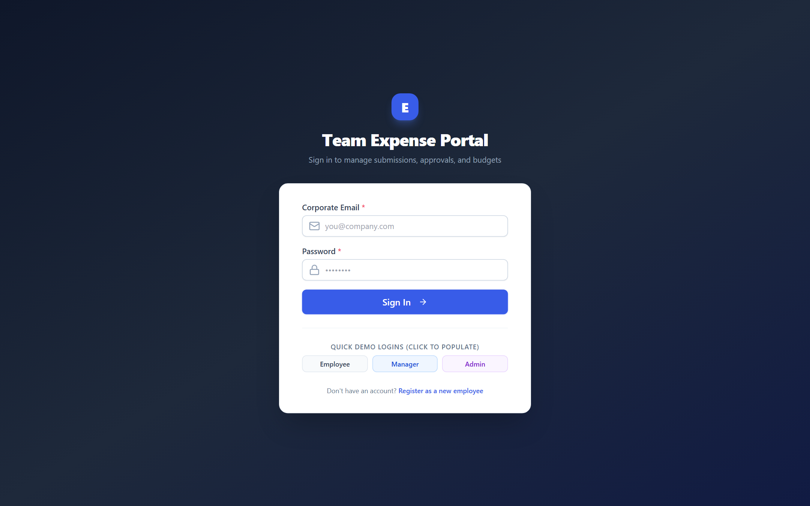

- **Route & API**: `/login` &rarr; `POST /api/auth/login`
- **Key Features & UI Highlights**:
  - Clean centered card layout with subtle deep-navy corporate gradient.
  - Quick-fill demo credentials for **Employee**, **Manager**, and **Admin** to enable fast recruiter evaluation.
  - Real-time client-side email format validation and password masking.
  - Link to employee registration for new personnel joining the organization.
- **Behind the Scenes**: Authenticates via Spring Security 6 `AuthenticationManager`, issues HMAC-SHA256 signed JWT Bearer token with embedded user ID, role, and expiration timestamp.

---

### Screenshot 2: Employee Account Registration
*Self-service workforce onboarding with organizational department and reporting manager hierarchy mapping.*


- **Route & API**: `/register` &rarr; `POST /api/auth/register`
- **Key Features & UI Highlights**:
  - Comprehensive registration form collecting First Name, Last Name, Corporate Email, Password, Department, Job Title, Assigned Reporting Manager, and Account Role.
  - Dynamic dropdown populated from the backend database with active managers for hierarchical routing.
  - Password strength verification with show/hide toggle.
- **Behind the Scenes**: Validates corporate email uniqueness, hashes password with BCrypt (10 rounds), assigns `ROLE_EMPLOYEE`, establishes self-referential foreign key relationship to assigned manager, and writes initial `USER_REGISTER` audit event.

---

### Screenshot 3: Employee Expense Dashboard
*Personal finance command center with real-time reimbursement metrics, monthly spending charts, and policy guidelines.*

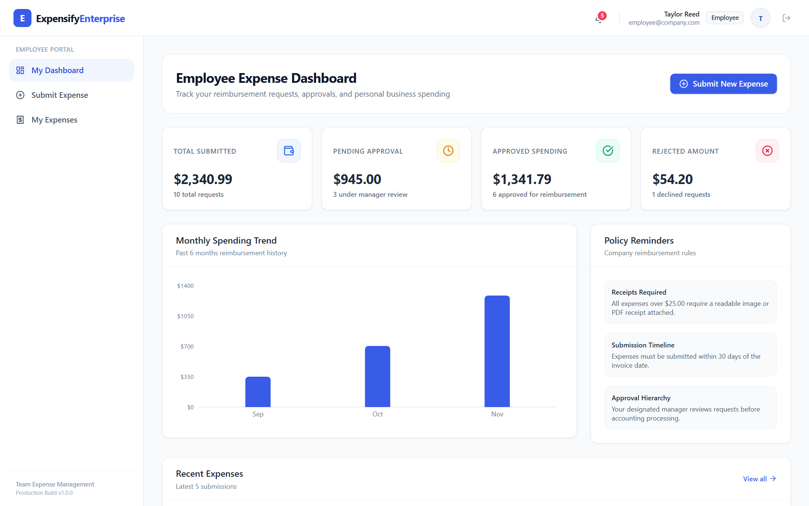

- **Route & API**: `/dashboard` &rarr; `GET /api/dashboard/employee`
- **Key Features & UI Highlights**:
  - Four financial metric cards calculating **Total Submitted** ($2,340.99 across 10 requests), **Pending Approval** ($945.00 under review), **Approved Spending** ($1,341.79 ready for repayment), and **Rejected Amount** ($54.20 declined).
  - Responsive Recharts bar chart displaying rolling monthly reimbursement trends (September through November).
  - Corporate policy reminder card summarizing receipt requirements ($25 threshold), 30-day submission windows, and approval hierarchy rules.
  - Quick-action button: `Submit New Expense` to immediately launch claim entry.
- **Behind the Scenes**: Aggregate calculations performed in database via JPA Specifications and Spring Data `BigDecimal` queries, preventing client-side rounding inaccuracies.

---

### Screenshot 4: Itemized Expense Submission Form
*Structured expense reimbursement claim form with multi-format receipt attachment and strict validation.*

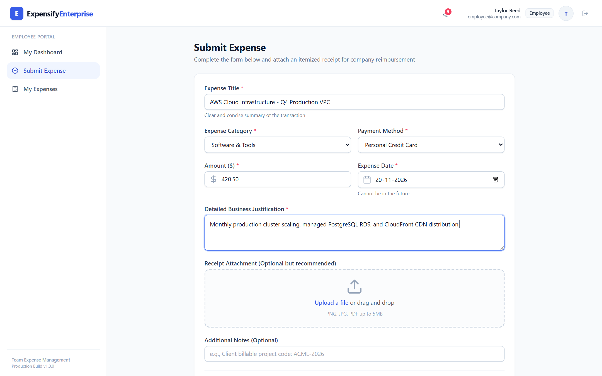

- **Route & API**: `/submit-expense` &rarr; `POST /api/expenses` (`multipart/form-data`)
- **Key Features & UI Highlights**:
  - Required fields: Expense Title, Expense Category dropdown, Payment Method (Company Card, Personal Card, Cash, Bank Transfer), Amount ($), and Expense Date.
  - Detailed business justification textarea and optional client billable project code notes.
  - Drag-and-drop receipt upload dropzone supporting PDF, PNG, and JPG formats up to 5MB.
  - Date picker enforcing `@PastOrPresent` validation rule (future dates are blocked with clear feedback).
- **Behind the Scenes**: Backend verifies MIME type, sanitizes file names with UUID prefixes to prevent directory traversal attacks, stores file to secure storage directory, creates `Expense` in `PENDING` state, logs initial status history, and dispatches in-app notification to the employee's assigned manager.

---

### Screenshot 5: Employee Expense Ledger & Status Tracking
*Comprehensive personal expense history table with dynamic status badges, filters, and self-service cancellation.*

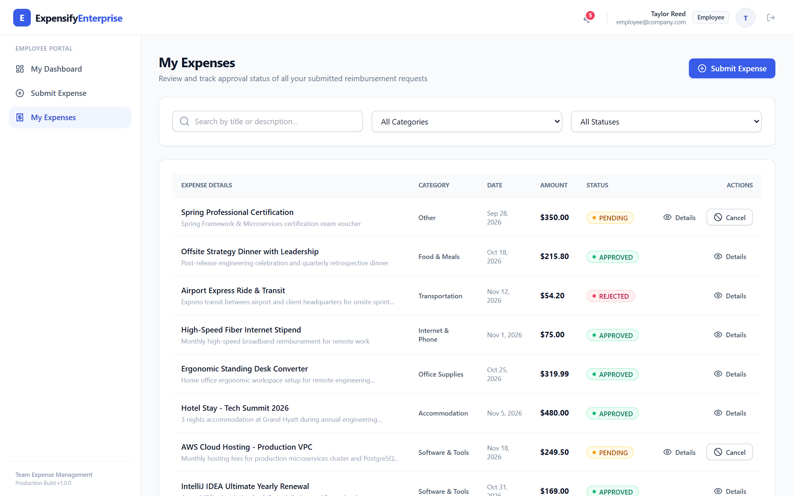

- **Route & API**: `/my-expenses` &rarr; `GET /api/expenses/my`
- **Key Features & UI Highlights**:
  - Live filter toolbar: free-text search by title/description, category dropdown, and status filter (`PENDING`, `APPROVED`, `REJECTED`, `CANCELLED`).
  - Itemized rows displaying Title & Subtitle, Category, Date, Formatted Amount (`$xxx.xx`), and color-coded status badges (Amber = Pending, Emerald = Approved, Rose = Rejected).
  - Action buttons: `Details` to view full timeline, and `Cancel` (visible only on `PENDING` items).
- **Behind the Scenes**: Spring Data JPA `Pageable` query scoped strictly to the authenticated `UserPrincipal` (`userId = principal.getId()`) to prevent Insecure Direct Object Reference (IDOR) attacks.

---

### Screenshot 6: Expense Breakdown & Approval Audit Trail
*Deep claim inspection view showing receipt attachments, financial metadata, and chronological status change timeline.*

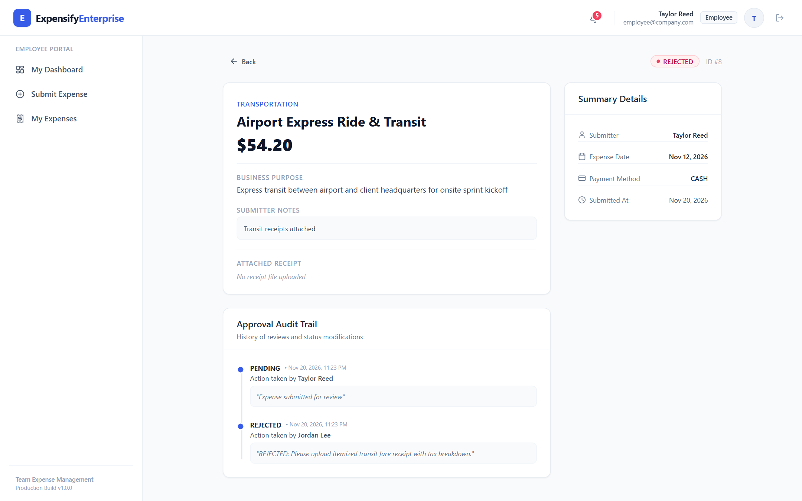

- **Route & API**: `/expenses/:id` &rarr; `GET /api/expenses/{id}` & `GET /api/expenses/{id}/history`
- **Key Features & UI Highlights**:
  - Top summary cards: Category tag, Expense Title, total claim amount in bold financial styling, Submitter Name, Expense Date, Payment Method, and Submission Timestamp.
  - Receipt download/preview link with proper content-type handling.
  - **Approval Audit Trail**: Visual chronological timeline tracing the request from initial submission (`PENDING`) through managerial decision (`REJECTED`), showing the acting manager (Jordan Lee), timestamp, and mandatory rejection feedback note (*"REJECTED: Please upload itemized transit fare receipt with tax breakdown."*).
- **Behind the Scenes**: Backend verifies access permissions before serving expense details (only submitter, assigned manager, or admin may view). The audit trail is pulled from `ExpenseStatusHistory` to provide complete dispute transparency.

---

### Screenshot 7: Manager Approval Dashboard
*Departmental oversight dashboard tracking direct reports' submissions, team spending volume, and pending tasks.*

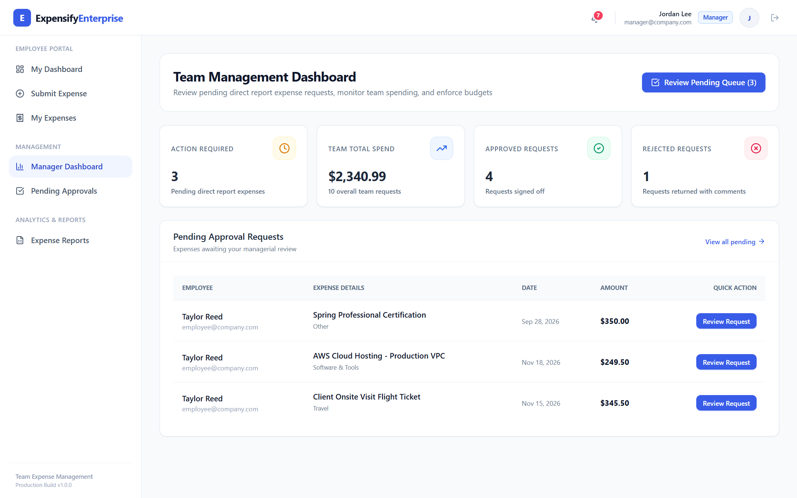

- **Route & API**: `/manager` &rarr; `GET /api/dashboard/manager`
- **Key Features & UI Highlights**:
  - Manager KPI cards: **Action Required** (3 pending direct report claims), **Team Total Spend** ($2,340.99 across 10 submissions), **Approved Requests** (4 signed off), and **Rejected Requests** (1 returned with comments).
  - Quick action banner: `Review Pending Queue (3)` leading directly to the decision list.
  - Recent pending submissions summary table with submitter name, email, claim title, date, amount, and direct `Review Request` shortcut buttons.
- **Behind the Scenes**: Manager queries filter claims exclusively by `user.manager_id = managerId`. Enforces segregation of duties by blocking managers from approving their own expenses.

---

### Screenshot 8: Manager Pending Approvals Queue
*Dedicated decision queue for team managers with one-click approval and mandatory rejection reasoning modal.*

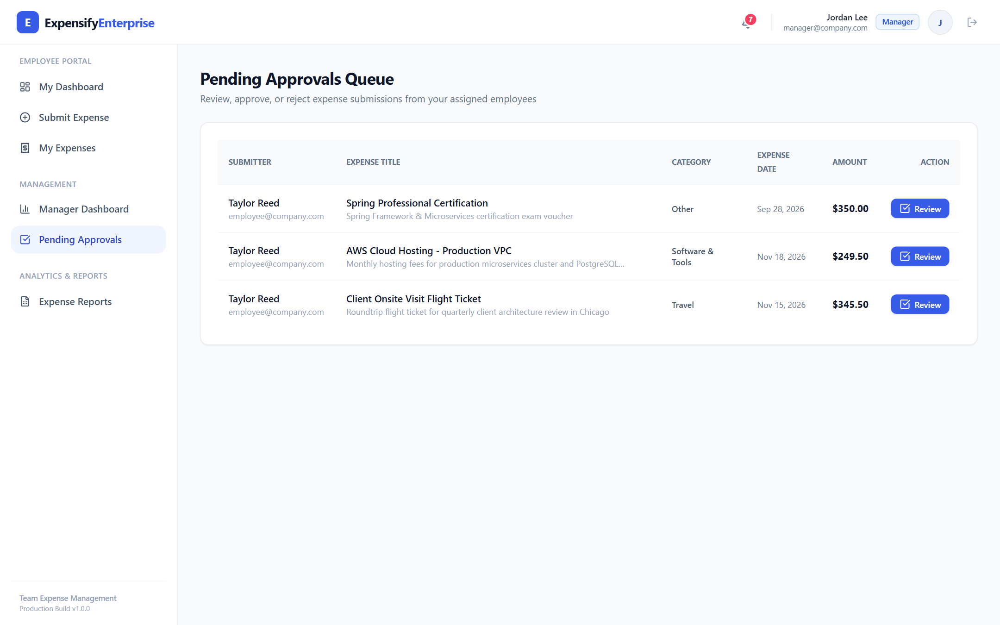

- **Route & API**: `/approvals` &rarr; `GET /api/approvals/pending`
- **Key Features & UI Highlights**:
  - Focused decision-making view displaying submitter profile (Taylor Reed), claim description, category, submission date, amount, and `Review` action button.
  - Clicking `Review` opens a modal showing receipt preview, itemized claim lines, and two explicit decision triggers: `Approve Expense` (single click with optional comment) and `Reject Expense` (enforces mandatory non-empty rejection justification before enabling the button).
- **Behind the Scenes**: Decision endpoints (`POST /api/approvals/{id}/approve` and `POST /api/approvals/{id}/reject`) execute inside transactional service methods that record reviewer identity, update parent status, insert an `ExpenseApproval` record, write an `ExpenseStatusHistory` event, and notify the submitting employee.

---

### Screenshot 9: Executive Finance & Admin Overview
*C-suite and finance administrator dashboard displaying company-wide expenditures, workforce metrics, and visual distribution.*

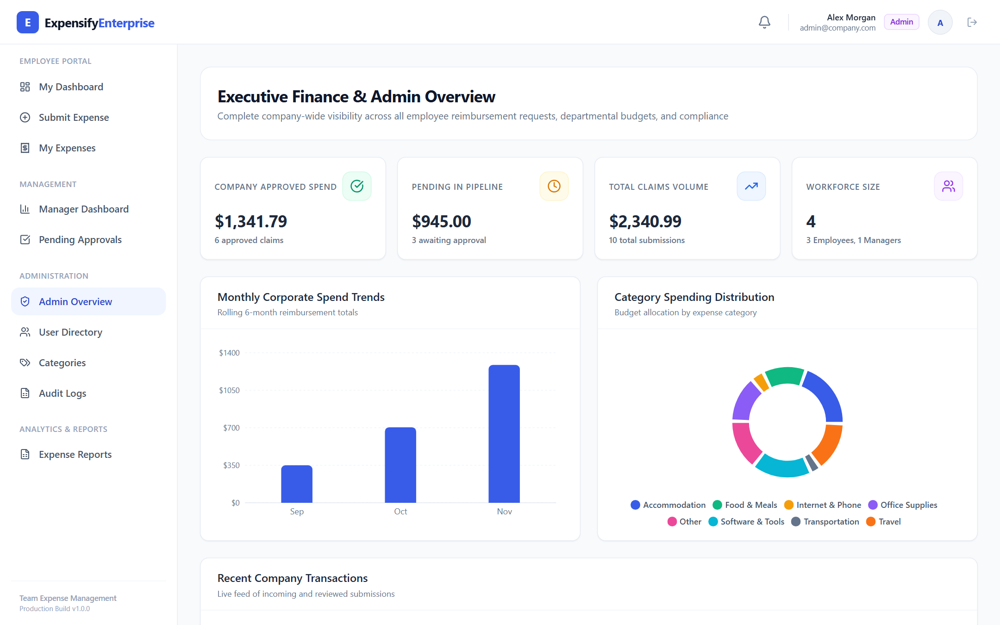

- **Route & API**: `/admin` &rarr; `GET /api/dashboard/admin`
- **Key Features & UI Highlights**:
  - Executive financial summary: **Company Approved Spend** ($1,341.79 across 6 claims), **Pending in Pipeline** ($945.00 awaiting sign-off), **Total Claims Volume** ($2,340.99 submitted), and **Workforce Size** (4 active accounts: 3 employees, 1 manager).
  - Dual Recharts analytics panels:
    - **Monthly Corporate Spend Trends**: Multi-month volume comparison bar chart.
    - **Category Spending Distribution**: Interactive donut chart with legend showing budget allocations across Accommodation, Food & Meals, Internet & Phone, Office Supplies, Software & Tools, Transportation, and Travel.
- **Behind the Scenes**: Backend executes aggregated JPA group-by queries on `ExpenseCategory` and month-trunc functions, returning type-safe `BigDecimal` totals directly to the frontend chart components.

---

### Screenshot 10: Workforce User Management & Hierarchy Directory
*Administrative workforce directory for role management, reporting manager assignments, and account status controls.*

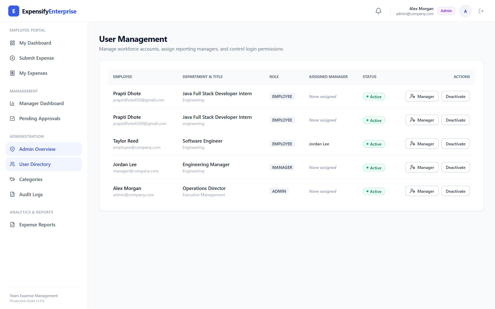

- **Route & API**: `/admin/users` &rarr; `GET /api/users` & `PATCH /api/users/{id}/manager` & `PATCH /api/users/{id}/status`
- **Key Features & UI Highlights**:
  - Workforce data table displaying Employee Name, Corporate Email, Department & Title, Role badge (`EMPLOYEE`, `MANAGER`, `ADMIN`), Assigned Manager, Account Status (`Active` / `Inactive`), and Action buttons.
  - Interactive `Assign Manager` button opens a modal to dynamically change or reassign an employee's approval hierarchy.
  - `Deactivate` / `Activate` buttons to instantly revoke or restore employee system login privileges without deleting history.
- **Behind the Scenes**: Controller is protected by `@PreAuthorize("hasRole('ADMIN')")`. Manager assignment validates against circular hierarchy chains and self-assignment, updating audit logs for governance compliance.

---

### Screenshot 11: Expense Categories & Budget Classification
*Centralized administration for managing allowable reimbursement categories and company policy descriptions.*

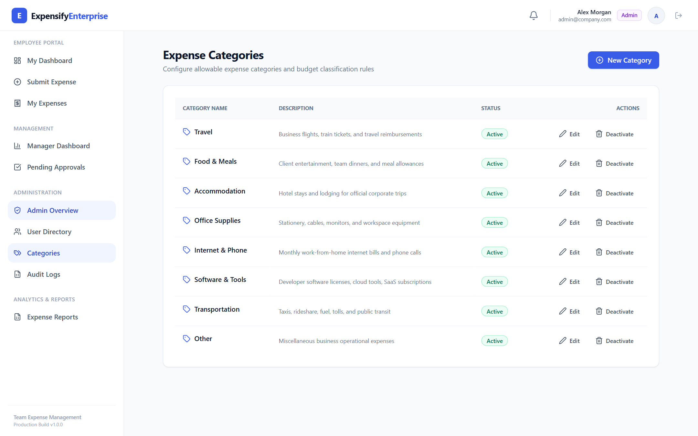

- **Route & API**: `/admin/categories` &rarr; `GET /api/categories` & `POST /api/categories` & `PUT /api/categories/{id}`
- **Key Features & UI Highlights**:
  - Management table listing all 8 standardized expense categories: Travel, Food & Meals, Accommodation, Office Supplies, Internet & Phone, Software & Tools, Transportation, and Other.
  - Description column detailing company reimbursement rules (e.g., *"Developer software licenses, cloud tools, SaaS subscriptions"*).
  - Status indicators (`Active`) and action buttons: `Edit` category metadata, `Deactivate` to retire obsolete codes, and `+ New Category` modal trigger.
- **Behind the Scenes**: When categories are deactivated, existing expense history maintains relational integrity without cascade deletions, preventing historical auditing inconsistencies.

---

### Screenshot 12: Expense Reports & Financial Auditing Suite
*Multi-dimensional financial filtering suite with instant RFC 4180 CSV export and print-ready auditing view.*

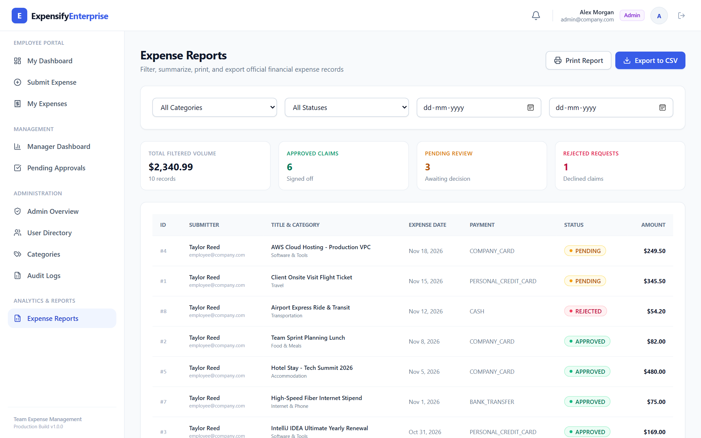

- **Route & API**: `/reports` &rarr; `GET /api/reports/expenses` & `GET /api/reports/export/csv`
- **Key Features & UI Highlights**:
  - Multi-parameter filter bar: Category dropdown, Status dropdown, Start Date picker, and End Date picker.
  - Live calculated aggregate summary cards: **Total Filtered Volume** ($2,340.99 across 10 records), **Approved Claims** (6 signed off), **Pending Review** (3 awaiting decision), and **Rejected Requests** (1 declined).
  - Data table with ID, Submitter Name, Email, Title & Category, Expense Date, Payment Method, Status badge, and Amount.
  - Export triggers: `Export to CSV` (streams an RFC 4180 CSV file directly from the Spring Boot backend) and `Print Report` (triggers browser print stylesheet with headers, totals, and signatures formatted for accounting filing).
- **Behind the Scenes**: `ReportServiceImpl` uses dynamic Spring Data JPA `Specification<Expense>` criteria queries to apply only selected filters, calculating exact sum totals using `CriteriaBuilder.sum()` with `BigDecimal`.

---

### Screenshot 13: System Audit Trail & Compliance Log
*Tamper-evident system activity log capturing security events, expense lifecycles, and managerial decisions.*

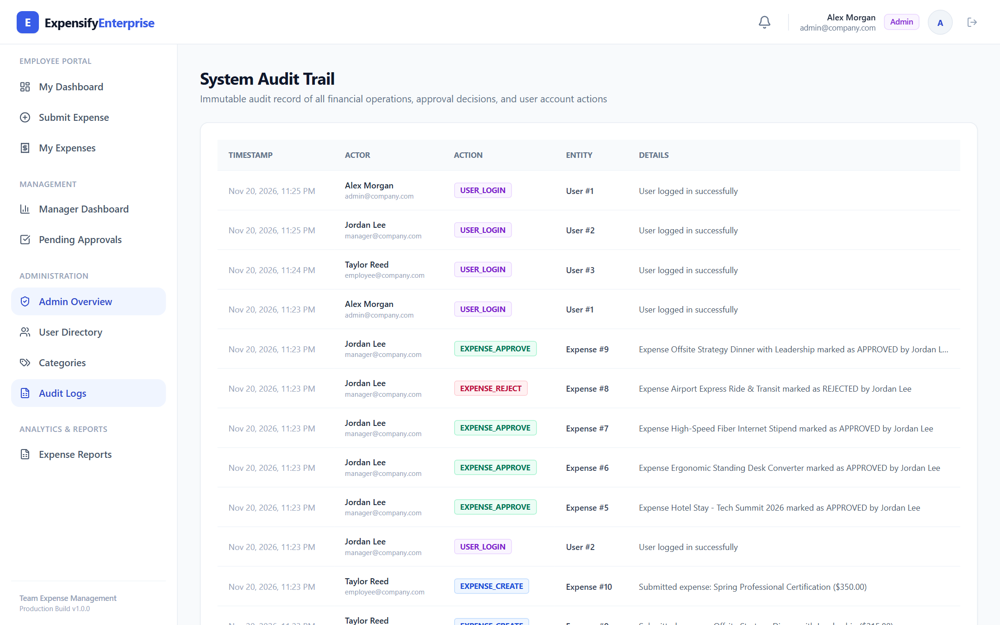

- **Route & API**: `/admin/audit-logs` &rarr; `GET /api/audit-logs`
- **Key Features & UI Highlights**:
  - Paginated audit log table displaying exact Timestamp, Actor Name & Email, Action badge (`USER_LOGIN`, `USER_REGISTER`, `EXPENSE_CREATE`, `EXPENSE_APPROVE`, `EXPENSE_REJECT`), Entity Reference (`Expense #8`, `User #1`), and human-readable Description.
  - Real-time logging of authentication events and status transitions.
- **Behind the Scenes**: Audit entries are written synchronously during business operations inside `@Transactional` service methods. The `AuditLog` entity is insert-only (no update or delete APIs exist), guaranteeing an immutable compliance trail for corporate auditing and SOX-style financial compliance.

---

## 13. Recommended Git Commit History

When pushing this codebase to your GitHub profile, commit in progressive, professional increments to demonstrate real-world software engineering workflow to technical recruiters:

1. **`feat: initialize repository with project specification and database schema`**
   - Add `.gitignore`, `database/schema.sql`, and `database/sample-data.sql`.
2. **`feat(backend): configure spring boot 3, jpa entities, and repositories`**
   - Implement `User`, `Role`, `ExpenseCategory`, `Expense`, `ExpenseApproval`, `ExpenseStatusHistory`, `Notification`, and `AuditLog` entities.
3. **`feat(security): implement spring security 6, bcrypt, and jwt filter chain`**
   - Add `JwtTokenProvider`, `JwtAuthenticationFilter`, `UserPrincipal`, `CorsConfig`, and `SecurityConfig`.
4. **`feat(service): implement core expense submission, approval workflow, and audit logging`**
   - Add `ExpenseServiceImpl`, `ApprovalServiceImpl`, `ReportServiceImpl`, `FileStorageServiceImpl`, and `NotificationServiceImpl`.
5. **`test(backend): add unit and integration test suite with junit 5 and mockito`**
   - Add unit tests for Auth, Approval, Expense, Report, and User services (18 tests).
6. **`feat(frontend): build react 18 spa with tailwind css and role-based dashboards`**
   - Implement Employee, Manager, and Admin dashboards, forms, Recharts visualizations, and Axios interceptors.
7. **`docs: add comprehensive readme with architecture diagrams, api specs, and setup instructions`**
   - Add complete `README.md`, Mermaid ER diagrams, workflow state machine, and Postman collection.

---

## Author & Project Info
- **Project**: Team Expense Approval & Management System
- **Intended Role**: Associate Software Engineer / Full-Stack Java Developer Portfolio
- **Designed & Implemented by**: Prapti Dhote (B.E. Information Technology)
